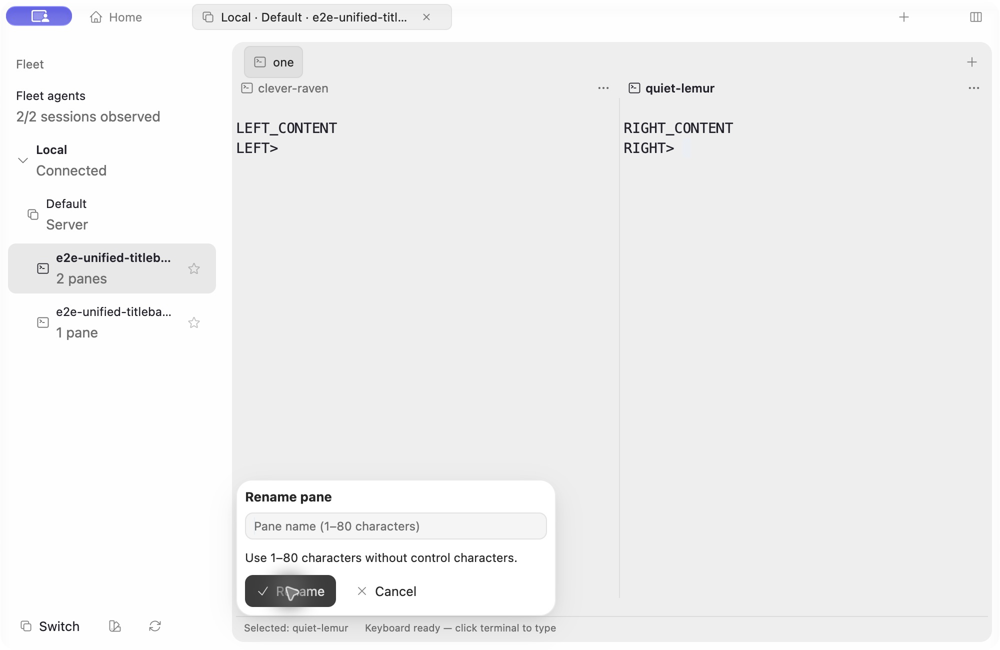
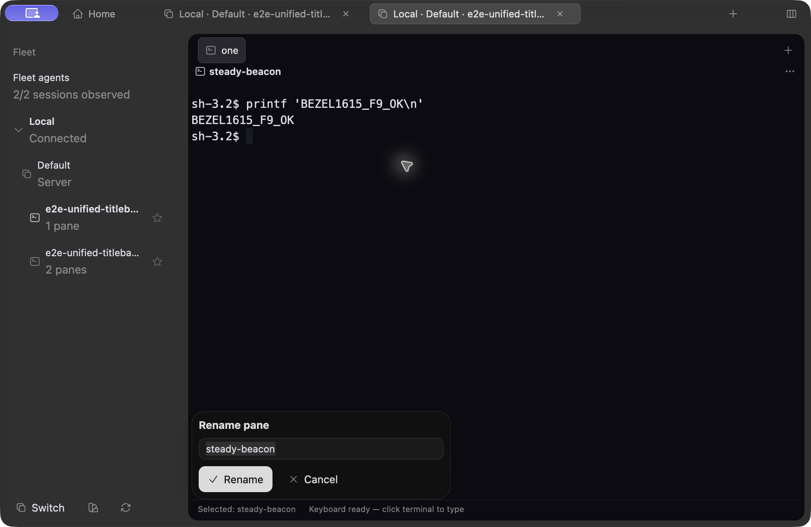

# Bezel alpha visual evidence

These screenshots show the real isolated Preview1615 native rename dialog in light and dark appearance. The light capture includes empty-name validation. They are not narrow-window or second-Mac evidence.

The signed candidate0.1.2 build2026101616 uses identical pre-signing native executable bytes: db0d0905248871eccb604e3e65c0abd61fd90a74326233639783b6f0c9ca0664. Its separate signing transformation and private installation passed. Signed terminal-input acceptance is still pending; these screenshots do not establish hardened-runtime input behavior.

