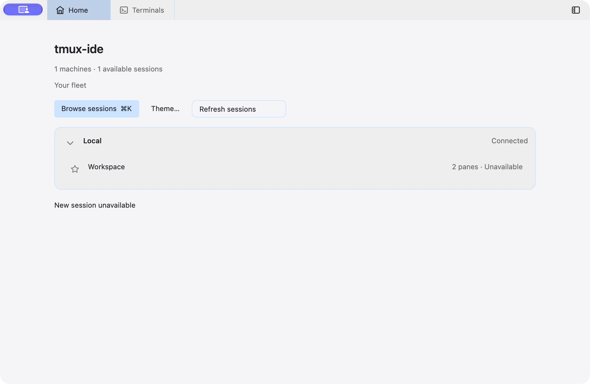
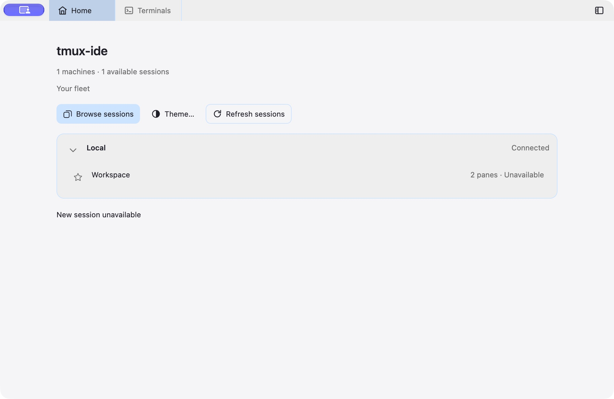
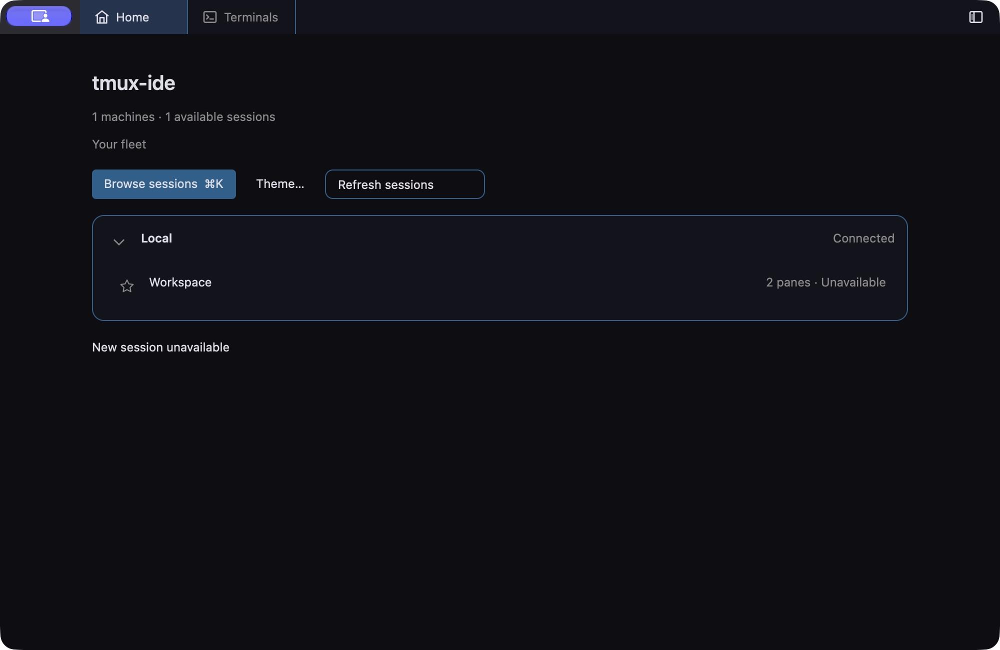
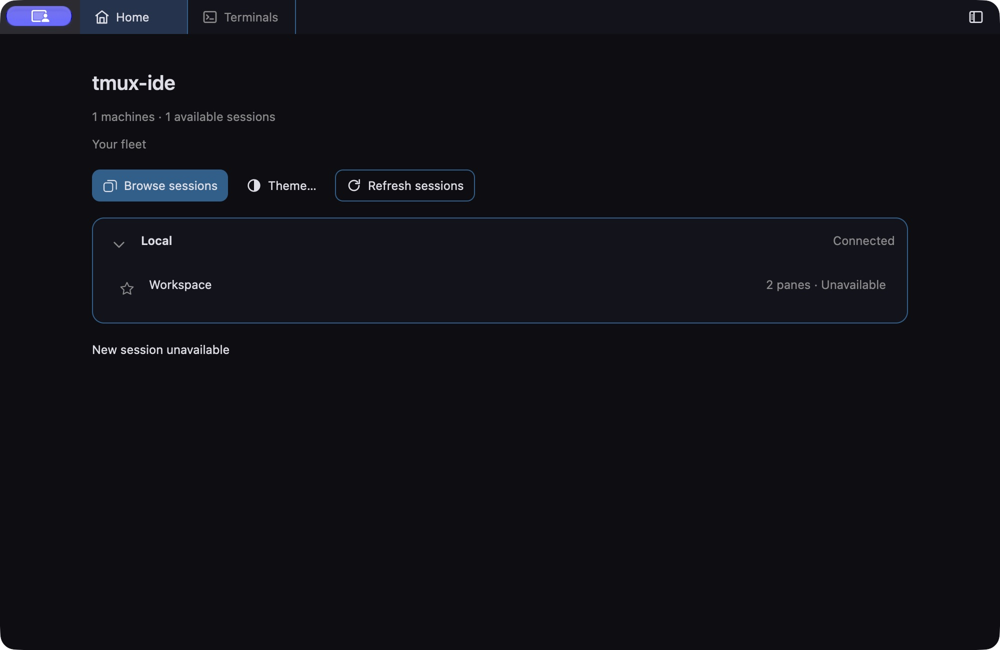
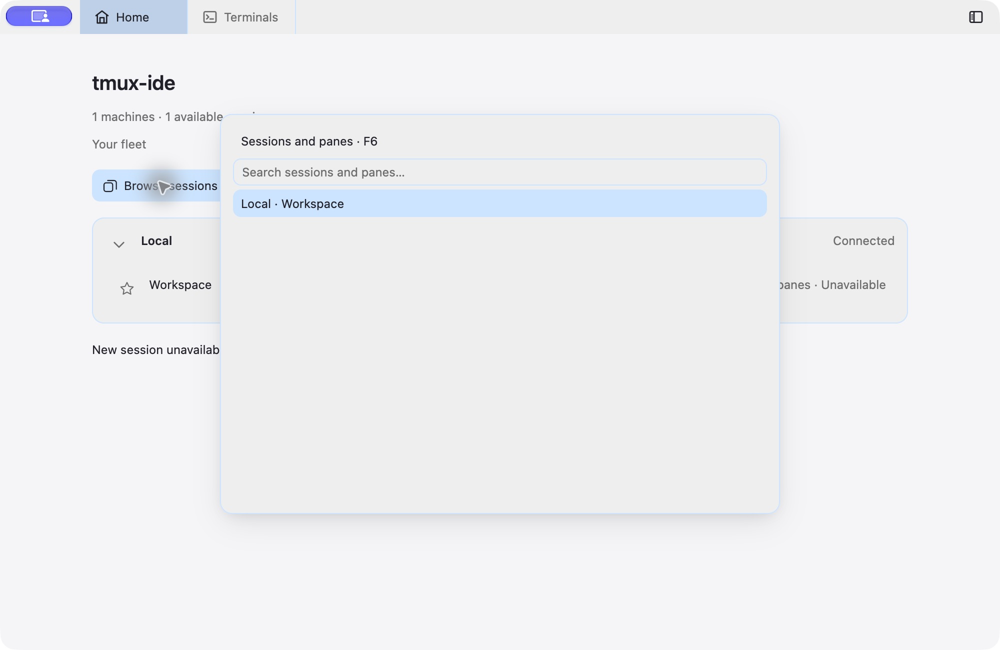
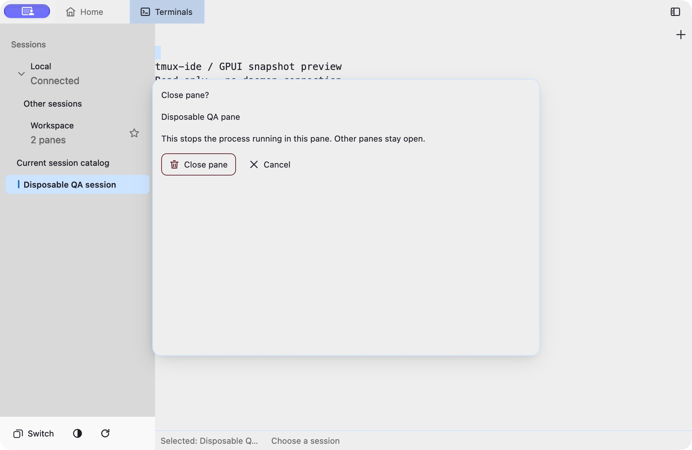
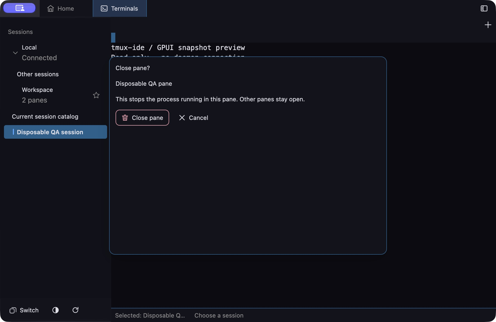
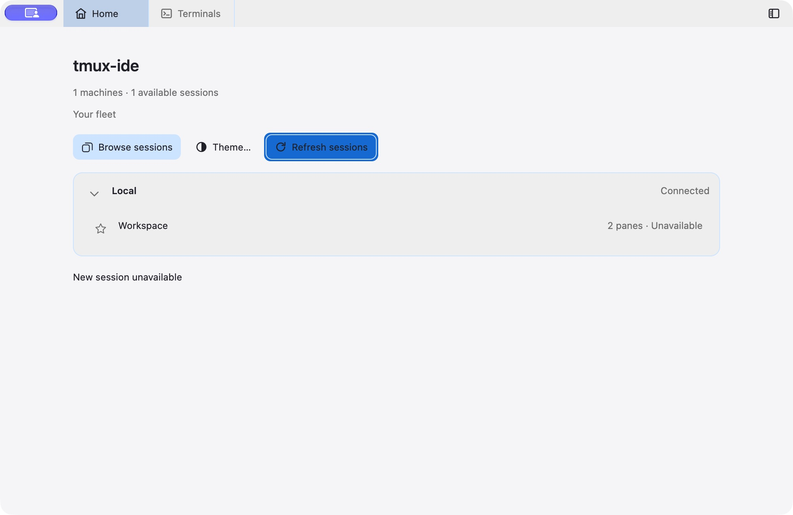
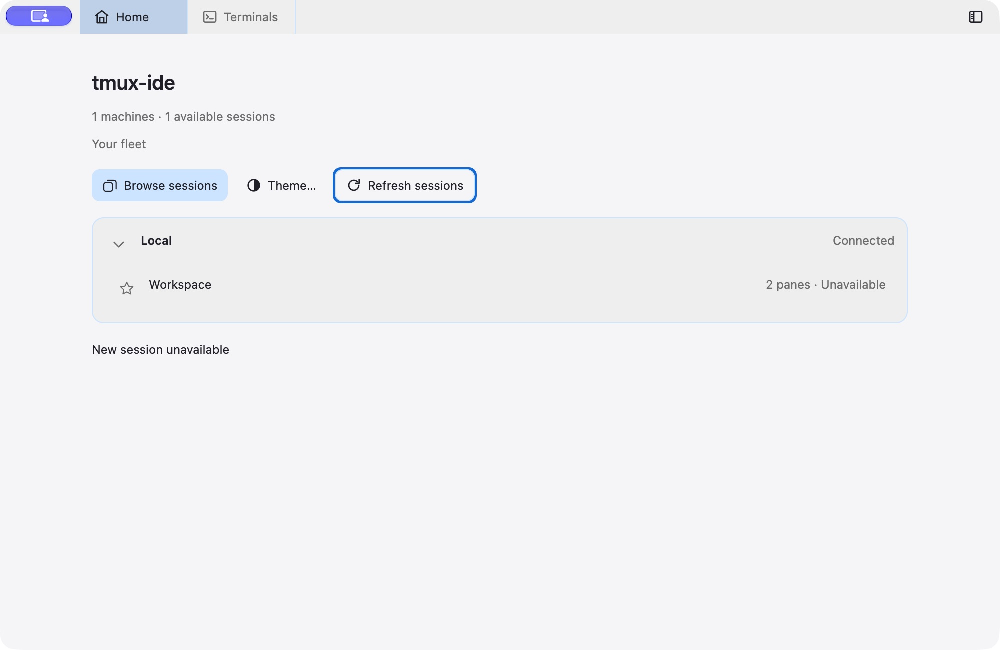
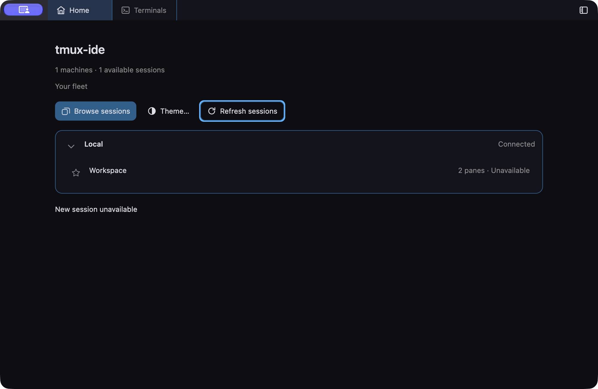

# NP04: shared Home actions, first slice

Home Browse, Theme and Refresh now use the same native control foundation with primary, quiet and secondary emphasis. Existing quiet callers, command owners and guards are unchanged. No new upstream code was copied in this slice.

## Verification

- cargo fmt --all -- --check: passed.
- bash scripts/check-file-size.sh: passed.
- cargo clippy --locked --workspace --all-targets --all-features -- -D warnings: passed.
- cargo clippy --locked --workspace --all-targets --no-default-features -- -D warnings: passed.
- cargo test --locked --workspace: passed; opt-in ignored tests remain unproven.
- cargo test --locked --workspace --all-features: passed; opt-in ignored tests remain unproven.
- cargo build --locked -p herdr-gpui --bin tmux-ide-gpui: passed.
- Independent final diff review: no blockers; original quiet styling and Home action guards preserved.
- Native light/dark inspection at 1000 x 650 logical pixels: consistent heights, readable icons and labels, no action-row clipping.
- Native Browse click opened Sessions and panes; Escape dismissed it. Theme click opened Appearance.
- Native Refresh click emitted exactly `{"type":"refresh","request":1}` on the isolated browser wire. This verifies native click routing, not daemon completion.

Screenshots use the repository browser-fleet fixture, isolated HOME and unique ad-hoc QA app identities; no production daemon connection. Baseline is native alpha 2026101410. New source binary SHA-256: `cac19b6ba405d4574e404c6cf73ef7f83e5c1481d6f1a05af6ca1f1130e7f3ac`.

## Remaining acceptance

Narrow native geometry has not been verified: attempted edge drags did not resize the QA window. Refresh end-to-end daemon behavior was not exercised by this static fixture. This is only the first NP04 slice, not completion of the design system or a release qualification. Wider control migration and disabled/pending/destructive states remain outstanding.

## Before and after

| Theme | Before                            | After                           |
| ----- | --------------------------------- | ------------------------------- |
| Light |  |  |
| Dark  |    |    |

## Accessibility follow-up

The shared action control now exposes Button role, a stable accessibility identifier and a visible-label-or-tooltip accessible name. Pressed feedback follows Herdr `titlebar/navigation.rs`'s stronger foreground wash (reference commit f75df59eb53d69a11322f092eb3e45706b72db87).

Both workspace test configurations passed the new public Element/AccessKit metadata test. The full formatting/file-size, both Clippy configurations, workspace suites and native build completed successfully for the semantic change. Tests confirm metadata and registered Click action, not platform AX dispatch.

A fresh private QA app exposed Browse sessions, Theme, Refresh sessions and the sidebar control in the real macOS accessibility tree (retained in accessibility-tree.txt). Activating Refresh by its named element emitted one refresh request. The automation API may implement this using pointer input; this is not a VoiceOver/AXPress certification.

Home keyboard traversal now has 42 passing focused tests, including Tab/Shift-Tab, Enter/Space activation, focus retirement and modal ownership. The initial activation failures were test-fixture defects: GPUI activates buttons on key-up, and Appearance requires a supplied appearance snapshot. The tests now send key-up and provide that snapshot; production guards were not weakened.

A separate regression reproduced a real owner-guard gap: background Refresh could enqueue a request while a picker was open. The shared Home action guard now requires the current Home request, a live command channel and no picker/new-session/pane-action overlay. See `modal-before.txt` (failure, before the test moved into its topic file) and `home-focused-after.txt` (42 passing tests).

Native Tab/Enter was verified on the earlier build. Native Space, the revised higher-contrast focus ring and final modal behavior remain unverified because the Mac is locked. The focus group currently covers the three Home actions, not whole-page keyboard traversal. Final keyboard/modal increment: formatting, file-size guard, both Clippy configurations, default and all-feature workspace tests, and native debug build all passed (gate process exit 0). Opt-in ignored GUI tests do not count as physical verification.

## Destructive pane control and unlocked native checks

Close pane confirmation now uses the existing Herdr `menu::danger` mark color for its icon and border; label and tooltip keep normal foreground contrast. Cancel remains quiet. No owner guard, request or queue behavior changed. Independent final review and full Rust gates (format/file size, both Clippy variants, default/all-feature tests and native build) passed before the following captures.

Fresh private stdio fixtures verified light/dark confirmation appearance at 1000×650 logical points. Cancel dismissed the dialog without a close command; reopening and clicking Close pane emitted exactly one captured pane-action. This validates UI routing only: the fixture has no real daemon or tmux processes. Existing headless stale/background/full-queue confirmation tests also passed in the full suites.

The fresh Home preview verified Tab→Tab→Space opens Appearance, Escape returns to Home, Shift-Tab reaches Refresh, and Enter emits one Refresh command. Browse's focus ring is now visibly stronger. A new native paint defect was found on transparent Theme/Refresh controls: their outer shadow fills the interior blue. A separate reviewed correction is rebuilding; these captures do not claim final focus acceptance. Narrow geometry, direct VoiceOver and live daemon journeys remain outstanding.

## Focus-paint correction verified

Native reproduction showed an outer box shadow filling transparent Theme/Refresh button interiors. The focus helper now supplies an opaque interior: existing active fill for Browse, Home canvas for Theme/Refresh. Hover/pressed styles still apply afterward, and geometry is unchanged. Independent review passed. Full formatting/file-size, both Clippy variants, default/all-feature workspace tests and native debug build passed again for this correction.

Fresh isolated native windows verify the focused Refresh interior remains unchanged in light and dark; its ring is visible. Tab/Tab/Space still opens Appearance after the correction. Screenshot dimensions remain 1000×650 logical points; attempted edge drags did not resize, so narrow physical layout remains unverified. These are static wire fixtures, not live-daemon qualification or direct VoiceOver dispatch.

## Unavailable new-window control

The existing unavailable Plus had no command callback but still painted hover and pressed feedback. The shared unavailable presentation now suppresses those affordances, keeps its accessible name, and describes why the action is unavailable. Existing capability, presence, request, modal and queue admission remain with their original owners. Herdr's `titlebar/navigation.rs` at the audited reference supplies the enabled-only styling pattern.

`unavailable-plus-before.png` captures the preserved earlier binary's hover wash. `unavailable-plus-light.png` and `unavailable-plus-dark.png` show the updated control after a click, without that wash; the pointer partly covers the icon, so these are interaction-state evidence rather than pixel-level icon verification. No pane-action command was emitted in either updated private fixture. `unavailable-plus.json` retains binary hashes and fixture caveats, including the updated light fixture's misleading local name. All three previews exited cleanly.

Focused tests passed: 13 unavailable-filter cases (including accessible name/reason/no Click action and unavailable-to-ready transition) and two existing new-window-strip cases. The transition test verifies no command or geometry change before capability arrives, then exactly one new-window command. Parent implementation review and subsequent source/evidence review found no blocker. Full workspace gates subsequently passed: format/file-size, both Clippy configurations, default/all-feature workspace tests and native debug build (session 93312 exit 0). No platform-disabled accessibility flag, VoiceOver activation, native narrow layout, or daemon integration is claimed by these fixtures.

## Theme readiness and keyboard recovery

Home and sidebar Theme controls now share the unavailable presentation while appearance settings are absent, omit activation callbacks, and explain why. Home keyboard navigation skips the unavailable control in both directions. If focused Theme loses availability, focus returns to the Home root; an active modal retains its own focus.

The private native fixture verifies unavailable-to-ready keyboard recovery and search input retained in an open Appearance picker after appearance disappears. See `theme-readiness.json` and its three screenshots. The fixture exited cleanly. These checks do not establish live-daemon integration, VoiceOver activation, or narrow native layout. Two new regression cases are included in the 56 passing theme-filter tests; independent review found no blocker.

Full local Rust gates passed (session 2384, exit 0): formatting/file-size, both Clippy configurations, default/all-feature workspace tests, and native debug build. GPUI counts are 2764/2795 passed, with 7/8 existing opt-in ignores; ignored checks are not claimed.

## Sidebar keyboard controls

Ctrl+G now owns an opt-in Tab/Shift+Tab cycle through session rows, Switch,
Theme, Refresh, sidebar visibility and the available new-window control.
Ordinary terminal Tab remains terminal input. Recovery footer clicks remain
available while terminal presence is pending; stale requests and modal changes
cannot activate an old control.

`sidebar-keyboard-verification.json` records the exact binary SHA-256, screenshot
hashes and private fixture command receipts. Native light checks opened the
session picker and hid/restored the sidebar; native dark checks showed the focus
ring and emitted one Refresh request without terminal key leakage. Both private
fixtures exited 0. No production daemon or tmux server was involved.

Final local gate session 33892 exited 0: formatting, file-size checks, both
Clippy configurations, native build and workspace tests passed. GPUI default:
2772 passed / 7 ignored; all features: 2803 passed / 8 ignored. Client tests:
217 passed in each configuration. Eight focused control tests passed. Earlier
failed test/build attempts are indexed in the JSON; they are retained under
`.tasks/native-polish-np04`, together with the passing logs.

Independent final source and capture review found no blockers. Two window-edge
drag attempts did not change window geometry, so narrow-window behavior is not
verified. VoiceOver and live-daemon qualification remain open. This is branch
work, not a merged or released feature.
